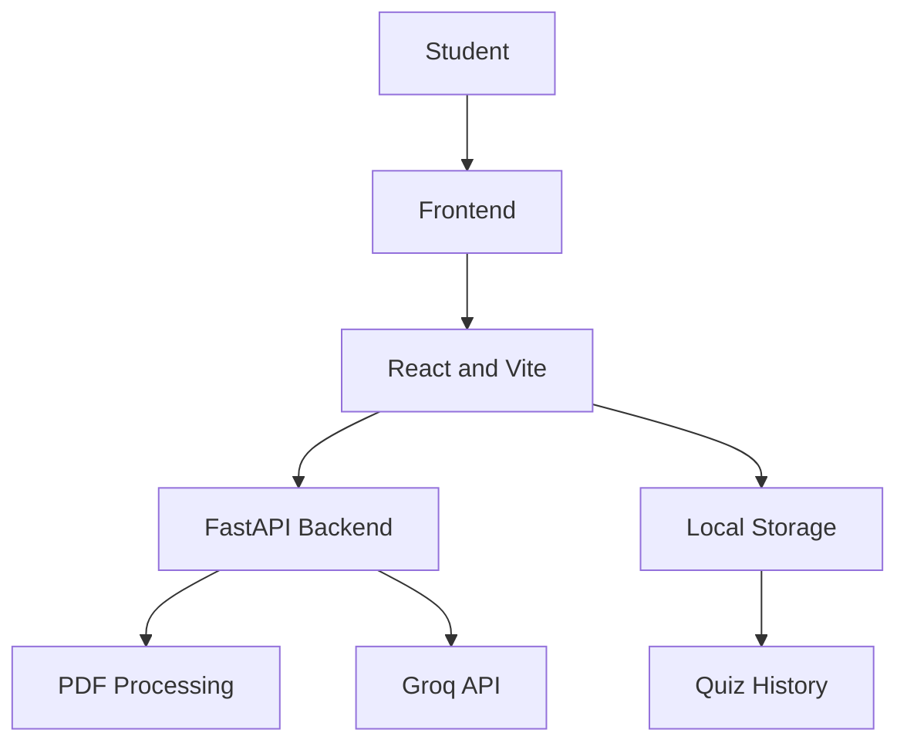

# StudyOS 📚

### Your Smart Study Space

StudyOS is an AI-powered study platform designed to help students learn smarter, organize study materials, and track their academic progress.

## ✨ Features

- **Dashboard:** View study statistics, recent activity, and saved study plans.
- **My Documents:** Upload and manage PDF study materials.
- **Smart Notes:** Generate AI-powered notes from uploaded PDFs and download them.
- **AI Tutor:** Ask questions based on uploaded study material.
- **Quiz & Practice:** Generate MCQ quizzes and get instant feedback with explanations.
- **My Progress:** Track quiz scores, performance, and weak topics.
- **Smart Revision:** Identify weak topics and manage revision tasks.
- **Study Timer:** Use a Pomodoro timer to improve focus.
- **AI Study Plan:** Generate and save personalized study plans.

## 🛠️ Tech Stack

### Frontend
- React.js
- Vite
- JavaScript
- CSS
- React Router

### Backend
- Python
- FastAPI
- PyMuPDF
- Groq API

## 📁 Project Structure

```text
StudyOS/
├── src/
│   ├── components/
│   ├── pages/
│   ├── App.jsx
│   └── App.css
├── backend/
│   ├── main.py
│   └── uploads/
├── public/
├── package.json
└── README.md
```

## 🚀 Getting Started

### 1. Clone the repository

```bash
git clone https://github.com/gauri06srivastava-create/StudyOS.git
cd StudyOS
```

### 2. Install frontend dependencies

```bash
npm install
```

### 3. Start the frontend

```bash
npm run dev
```

### 4. Set up the backend

Open a second terminal:

```bash
cd backend
python -m venv venv
```

Activate the virtual environment on Windows:

```powershell
.\venv\Scripts\Activate.ps1
```

Install dependencies:

```bash
pip install fastapi uvicorn python-multipart pymupdf groq python-dotenv
```

### 5. Configure environment variables

Create a `.env` file inside the backend folder:

```env
GROQ_API_KEY=your_groq_api_key
```

Never upload your API key to GitHub.

### 6. Start the backend

```bash
uvicorn main:app --reload
```

Backend runs at:

http://127.0.0.1:8000

## 🎯 Project Goal

StudyOS aims to provide students with a single platform for managing study materials, generating notes, practicing questions, tracking performance, and planning revisions.

## 👩‍💻 Developed By

**Gauri Srivastava**

GitHub: https://github.com/gauri06srivastava-create

---

⭐ If you find StudyOS useful, consider giving this repository a star!
 
## 🏗️ System Architecture

